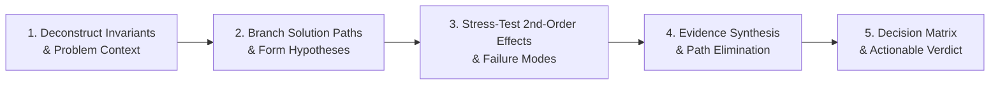

# AGY Advisor (`agy-advisor`)

Use this skill when you need an **independent second opinion**, architectural sound-check, or cross-model sanity check from Google Antigravity (`agy` / Gemini) powered by **Sequential Thinking (`sqthink`)** before committing to a technical direction.

---

## 🧠 The Sequential Thinking (`sqthink`) Advisory Framework

When analyzing complex technical questions, `agy-advisor` executes a rigorous 5-step cognitive reasoning pipeline:



### 1. Intent & Invariant Deconstruction (ถอดแกนความต้องการ)
- Isolate the core engineering problem from surface-level symptoms.
- Identify non-negotiable constraints (Performance SLA, memory footprint, security boundaries, zero-dependency requirements).

### 2. Solution Path Branching (แตกทางเลือกอย่างน้อย 2-3 เส้นทาง)
- Do not settle on the first obvious idea. Formulate distinct architectural approaches:
  - *Path A (Minimalist/Native):* Built with existing tools/Node built-ins without new deps.
  - *Path B (Established Pattern):* Standard industry-standard library/design pattern.
  - *Path C (Specialized/Advanced):* Tailored custom optimization.

### 3. Adversarial Stress-Testing & Second-Order Effects (วิเคราะห์จุดตายและผลกระทบต่อเนื่อง)
- What happens under high concurrency or network timeout?
- What are the operational overheads and long-term maintenance costs?
- What hidden failure modes exist if upstream services crash?

### 4. Evidence Synthesis & Falsification (หักล้างและคัดกรองด้วยหลักฐาน)
- Actively attempt to falsify assumptions using codebase evidence and benchmark constraints.

### 5. Structured Decision Matrix & Verdict (สรุปและฟันธงทิศทาง)
- Deliver a clear comparison table and an actionable recommendation.

---

## 🎯 Core Advisory Use Cases

1. ⚖️ **Architectural Trade-offs & Solution Comparison:**
   - Comparing database designs, concurrency primitives, caching strategies, or API protocols.
   - Example: *"Compare WebSockets vs SSE vs Long-Polling for our real-time quota telemetry under sqthink framework."*

2. 🧐 **Technical Sanity Checks & Blind Spot Detection:**
   - Reviewing major refactoring proposals or critical PRDs before touching code.
   - Example: *"I plan to refactor the plugin launcher to use worker threads. Run an sqthink sanity check on edge cases."*

3. 🩺 **Root Cause Analysis (RCA) Validation:**
   - Validating hypotheses for elusive production bugs or concurrency issues before implementing fixes.

4. 💡 **Anti-Overengineering & Simplicity Guard:**
   - Finding the leanest, most direct implementation that avoids unnecessary abstraction bloat.

---

## 🚀 Invocation

Prefer the MCP tool `agy_rescue` / `agy_review` with advisor prompt framing:

Fallback via script wrapper:

```bash
# Request an architectural second opinion with sqthink reasoning
node plugins/agy/skills/agy/scripts/agy-codex.mjs rescue "Apply sqthink to provide an architectural second opinion on [proposed design/question]"
```

---

## 📋 Advisor Response Structure

1. 🎯 **Executive Verdict:** Direct verdict (Endorsed / Caution / Alternative Recommended).
2. 🧠 **Sequential Reasoning Breakdown:** Step-by-step evaluation of constraints, branching hypotheses, and failure modes.
3. 📊 **Trade-off Decision Matrix:** Side-by-side comparison table (Complexity, Latency, Failure Resilience, Maintenance).
4. 🏁 **Prescribed Action Plan:** Step-by-step implementation roadmap.
