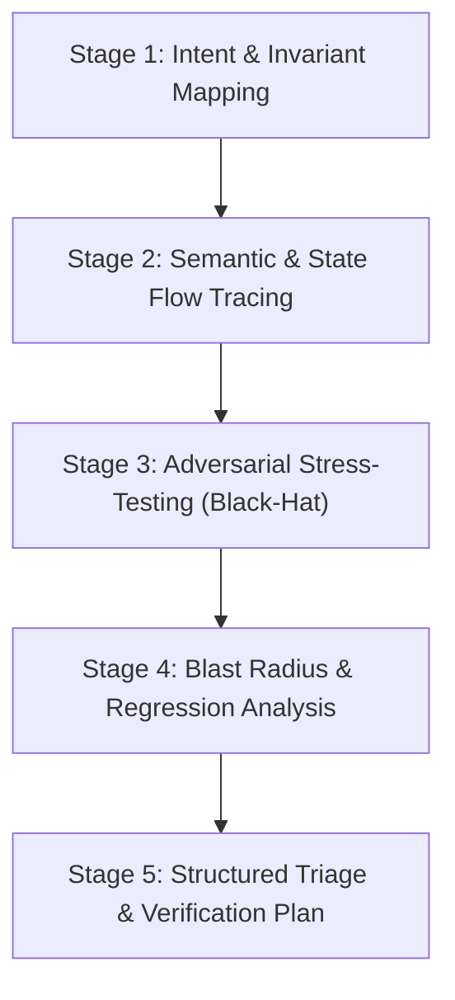

# AGY Diff Inspector (`agy-diff-inspector`)

Use this skill when you need an autonomous, deep adversarial inspection of code changes (Git Working Tree, Staged Changes, or Branch Diffs) via Google Antigravity (`agy`) guided by **Sequential Thinking (`sqthink`)**.

Unlike surface-level code reviews, `agy-diff-inspector` breaks down diff hunks through a systematic, multi-stage reasoning pipeline to catch elusive bugs, race conditions, and security flaws before merge.

---

## 🧠 The Sequential Thinking (`sqthink`) Diff Audit Pipeline

Every inspection follows a strict 5-stage sequential reasoning pipeline:



### Stage 1: Intent & Invariant Mapping (ทำความเข้าใจเป้าหมายและแกนระบบ)
- Parse commit intent or PR goal.
- Map the invariant constraints of modified modules (e.g. read-only guarantees, transaction boundaries, idempotency).

### Stage 2: Semantic & State Flow Tracing (ไล่เส้นทาง State และ Data Flow)
- Trace modified variables, function signatures, and async lifecycles across callers.
- Identify implicit type coercions, unhandled `null`/`undefined` branches, and un-awaited promises.

### Stage 3: Adversarial Stress-Testing / Black-Hat Mode (สวมหมวกดำเค้นหาจุดพัง)
- 💥 **Concurrency & Race Conditions:** What happens when two requests hit this code concurrently? Is shared state locked/isolated?
- 🔒 **Security Boundary Violations:** Are inputs sanitized? Can parameters be manipulated? Are secrets or tokens leaked in logs?
- ⏱️ **Timeouts & Resource Exhaustion:** Are loops bounded? Are sockets and file handles properly released in `finally` blocks?

### Stage 4: Blast Radius & Regression Analysis (ประเมินผลกระทบวงกว้าง)
- Check downstream dependencies for broken contracts.
- Evaluate backwards compatibility of altered schemas, APIs, or database queries.

### Stage 5: Structured Triage & Verification Plan (จัดลำดับความสำคัญและแผนทดสอบ)
- Group findings into actionable severity levels with exact line citations and concrete remediation code.

---

## 🚀 Invocation

Prefer the MCP tools `agy_adversarial_review` or `agy_review` when available.

Fallback via script wrapper:

```bash
# Sequential inspection on working tree changes
node plugins/agy/skills/agy/scripts/agy-codex.mjs review "Apply sqthink diff inspection: focus on concurrency and regressions"

# Deep adversarial inspection against base branch
node plugins/agy/skills/agy/scripts/agy-codex.mjs adversarial-review "--base main Apply sqthink pipeline to audit security boundaries"
```

---

## 📋 Structured Output Triage

The inspector organizes findings into 3 actionable tiers:

- 🔴 **Tier 1: Critical Blockers (Must Fix)**
  - Bugs causing data loss, security vulnerabilities, fatal runtime crashes, or breaking contract regressions.
- 🟡 **Tier 2: Warnings & Scalability Concerns**
  - Performance bottlenecks, missing error boundaries, potential memory leaks, or missing automated tests.
- 🟢 **Tier 3: Residual Risk Assessment**
  - Explicit statement of low-risk areas, verified invariants, and suggested regression test cases.
