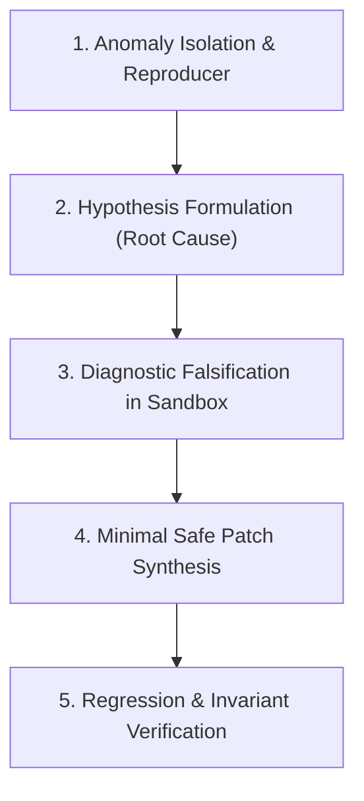

# AGY Task Rescue (`agy-task-rescue`)

Use this skill when you encounter a stuck problem, complex regression, failing test suite, or tricky runtime bug that requires a systematic, sandboxed sub-agent investigation via Google Antigravity (`agy`) guided by **Sequential Thinking (`sqthink`)**.

---

## 🧠 The Sequential Thinking (`sqthink`) Rescue Framework

Every rescue task follows a structured 5-step problem-solving discipline:



### 1. Anomaly Isolation & Smallest Reproducer (แยกแยะอาการและจำลองปัญหา)
- Extract the exact error message, stack trace, and failing preconditions.
- Construct the minimal reproduction command/script to isolate the failure from noise.

### 2. Root Cause Hypothesis Formulation (ตั้งสมมติฐานต้นตอ)
- Formulate 2-3 distinct hypotheses for why the failure occurs (e.g. race condition, unhandled edge-case input, incorrect environment assumption, stale cache).

### 3. Diagnostic Falsification in Sandbox (ทดสอบหักล้างสมมติฐาน)
- Run isolated probes/tests in the sandboxed process to disprove incorrect hypotheses.
- Narrow down to the single proven root cause with concrete evidence.

### 4. Minimal Safe Patch Synthesis (ออกแบบการแก้ไขที่เล็กที่สุดและปลอดภัย)
- Draft the smallest contiguous edit that resolves the root cause.
- Ensure no collateral damage or unneeded refactorings are introduced.

### 5. Regression & Invariant Verification (รันเทสต์ยืนยันผล 100%)
- Execute relevant test commands (`npm test`, unit tests) to verify the patch turns Red into Green without causing new regressions.

---

## 🛡️ Sandbox Safety Guarantees

- **Strict Read-Only by Default:** The rescue agent operates in read-only mode and proposes solutions unless file edits are explicitly requested.
- **Smallest Safe Diff:** When file modification is requested, only the minimal necessary contiguous edit is applied.
- **Self-Contained Execution:** Operates within workspace boundaries without leaking state to parent session.

---

## 🚀 Invocation

Prefer the MCP tool `agy_rescue` when available.

Fallback via script wrapper:

```bash
# Sequential rescue on a failing test suite
node plugins/agy/skills/agy/scripts/agy-codex.mjs rescue "Use sqthink to diagnose and fix the failing test in tests/quota-dashboard.test.mjs"

# Background deep investigation with timeout
node plugins/agy/skills/agy/scripts/agy-codex.mjs rescue "--background --timeout 45s Use sqthink to isolate memory leak in server.js"
```

## 📊 Status & Job Inspection

```bash
# Check running/recent jobs
node plugins/agy/skills/agy/scripts/agy-codex.mjs status

# Read captured output
node plugins/agy/skills/agy/scripts/agy-codex.mjs result "<job-id>"
```
