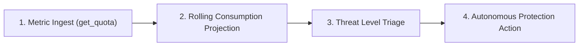

# Quota Guard Skill (`quota-guard`)

Use this skill to inspect, protect, and proactively manage your Antigravity (AGY) model quota budgets and remaining AI Premium credits using a **Sequential Thinking (`sqthink`)** decision pipeline.

---

## 🧠 The Sequential Thinking (`sqthink`) Quota Governance Flow



### 1. Metric Ingestion & Invariant Inspection
- Invoke `get_quota` MCP tool to fetch structured percentages and reset countdowns for:
  - Gemini Models: 5-Hour rolling limit & Weekly limit
  - Claude and GPT Models: 5-Hour rolling limit & Weekly limit
  - AI Premium Credits balance

### 2. Rolling Consumption Rate Projection
- Compare remaining percentage against time remaining until the next reset window:
  - *Burn Rate Index:* Is the quota depleting faster than the reset timer recovery?

### 3. Threat Level Triage
- 🟢 **Level 0 (Normal - >35% remaining):** Safe for heavy reasoning models (Gemini Pro, Claude 3.7 Sonnet).
- 🟡 **Level 1 (Warning - 15% - 35% remaining):** Recommend prompt token compression or switching to Flash models.
- 🔴 **Level 2 (Critical - <15% remaining):** Proactively trigger fallback and launch dashboard UI.

### 4. Autonomous Protection Actions
- Automatically invoke `open_dashboard` MCP tool to open the live monitor at `http://localhost:3838`.
- Alert the user with actionable next steps (Switch model to `Gemini Flash`, upgrade credits, or pause automated cron tasks).

---

## 🚀 Invocation

```bash
# Check quota status via MCP
get_quota

# Open live dashboard UI
open_dashboard
```
